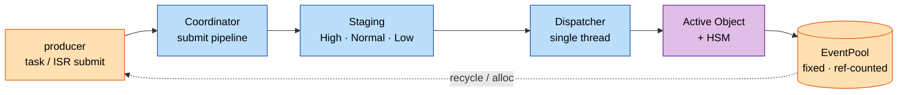
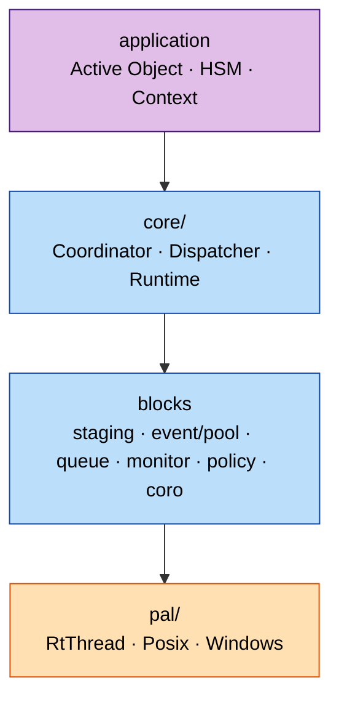

[中文](README_zh.md) | **English**

# coact

[](https://github.com/DeguiLiu/coact/actions/workflows/ci.yml)
[](https://opensource.org/licenses/MIT)

coact (**Co**operative **Act**ive-object framework) is a header-first **C++17**
event framework whose active-object and hierarchical state machine model follows
[QP/C++](https://www.state-machine.com/qpc/) by Quantum Leaps. It targets
single-core MCUs running **RT-Thread** or **FreeRTOS**, and the same headers
build and run on **Linux** and **Windows** hosts through the Posix and Windows
PALs (host is a test reference, not a product target). Producers submit events
from task or ISR context; one dispatcher thread delivers them to **active
objects** whose behaviour is a **hierarchical state machine**. Events replace
threads, transition tables are `constexpr`, and nothing allocates at run time.
The submission, staging, admission, breaker and PAL layers are coact's own.


## Why coact

- **C++17 only, no code generator.** Transitions are ordinary `constexpr` tables
  in your translation unit; no modelling tool sits in the build.
- **Single core is the design point.** `SingleCoreCriticalRing` plus an injected
  `CriticalSection` (irq mask on RT-Thread, task critical section / ISR mask on
  FreeRTOS) keeps the ISR path lock-free and libatomic-free; host SMP is a test
  reference, not the product target.
- **Fixed capacity, zero hot-path allocation.** A fixed-size `EventPool` recycled
  by ref-count lets one event fan out safely (`-fno-exceptions -fno-rtti`).
- **RT-Thread and FreeRTOS.** Both PALs use
  caller-provided static resources and never allocate; Linux and Windows hosts
  build from the same headers through the same PAL boundary.
- **Deterministic wakeups.** The dispatcher wakes only when idle and a drain-check
  closes the missed-wakeup window; `try_submit_from_isr` never blocks.
- **Back-pressure, not silent drops.** A breaker degrades under overload; the
  low-priority partition ages out instead of starving.

## Why C++17

C can implement everything coact does. The difference is who enforces the
constraints: in C, capacity relationships, resource ownership, handle types and
cleanup pairing live in comments, naming prefixes and review checklists; in
C++17, part of them lives in the type system and in compile-time assertions.
coact uses only that subset: no exceptions, no RTTI, no heap, no code generator.
Against an equivalent C implementation the cost is about 1 to 2 KiB more flash
and roughly the same RAM. The measurements, the cases where C wins and the
limits of the approach are in
[C++17 与 C 的能力差异、成本与使用边界](docs/cpp17_necessity_zh.md) (Chinese).

## Topology and layering





## Quick start (host)

```sh
cmake -B build -S . -DCMAKE_BUILD_TYPE=RelWithDebInfo && cmake --build build -j && ctest --test-dir build
```

```cpp
#include "coact/runtime.hpp"
#include "coact/pal_posix.hpp"
coact::pal::Posix pal;
coact::Runtime<coact::DefaultConfig, coact::pal::Posix> rt(pal);
rt.bind(&my_ao);          // my_ao : coact::Ao<Ctx, Hsm, Traits>
rt.initialize();
rt.start();
```

On RT-Thread include the same headers, select `coact/pal_rtthread.hpp` and compile
`src/core/pal_rtthread.cpp` into the BSP — the PAL uses caller-provided static
resources and never allocates.

On FreeRTOS select `coact/pal_freertos.hpp` and compile
`src/core/pal_freertos.cpp`; `FreeRtosResources` owns the dispatcher/worker
stacks and every kernel object. The port requires a single-core build with
static allocation enabled; Cortex-M0/M0+ is not supported.

## Modules

`event` `pool` `queue` `hsm` `ao` `staging` `monitor` `policy` `coro` `pal`
`span`, with
`coordinator` / `dispatcher` / `runtime` as the assembly
([`docs/interface_contract.md`](docs/interface_contract.md)).

## Testing

Host targets pass under `ctest` and are TSan-clean on the pool/dispatcher paths;
CI adds ASan/UBSan and a Windows MSVC job, and a weekly or on-demand `renode` job runs the Cortex-M4 fixtures below. Brought up on RT-Thread under
qemu-vexpress-a9 (single core) and on FreeRTOS under Renode (Cortex-M4 running
the CM3 port), including a fault-injection fixture where IWDG resets a task that
masks interrupts and spins.

## Credits

The active-object execution model, the pooled-event and reference-count
semantics, and the dispatcher loop follow
[QP/C++](https://www.state-machine.com/qpc/) by Quantum Leaps. Quantum Leaps
ships SafeQP/C++ (commercial) with certification kits for IEC 61508 and
ISO 26262; coact is not a certified product and carries no certification
artifacts. coact's own work is the submission pipeline, three-partition staging,
admission and breaker policies, the PAL abstraction and the single-core
lock-free queues.

## License

MIT — see [`LICENSE`](LICENSE).
