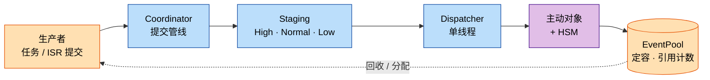
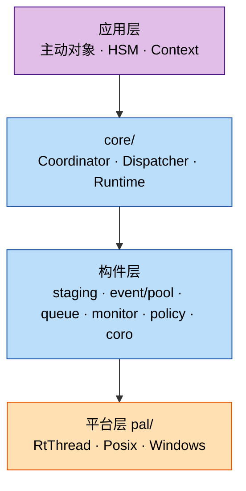

**中文** | [English](README.md)

# coact

[](https://github.com/DeguiLiu/coact/actions/workflows/ci.yml)
[](https://opensource.org/licenses/MIT)

coact（**Co**operative **Act**ive-object framework）是一个 header-first
**C++17** 事件框架，主动对象与层次状态机模型参考 Quantum Leaps 的
[QP/C++](https://www.state-machine.com/qpc/)。目标平台是运行 **RT-Thread** 或
**FreeRTOS** 的单核 MCU，同一套头文件也能通过 Posix / Windows PAL 在 **Linux** 与
**Windows** 主机上编译运行（主机侧是测试参考，不是产品目标；Windows 覆盖事件、
AO/HSM、队列、暂存、策略、熔断与 Windows PAL，`coro/` 与 `timer.hpp` 依赖
pthread，只在 POSIX 宿主上构建）。生产者从任务或 ISR
提交事件，由单一线程派发给行为由层次状态机描述的主动对象；事件代替线程，转移表是
`constexpr`，运行期不做分配。提交管线、分区暂存、准入、熔断与 PAL 是本项目自己的
实现。

下面三件事是结构属性，不是承诺：

| 性质 | 在代码里的落点 | 怎么验证 |
|---|---|---|
| 有界 | 队列、事件池、批大小全是编译期常量；无堆分配（只用 placement new）、无运行期动态注册 | 最坏占用与最长批在链接时固定（`test/renode/footprint.sh`） |
| 可检测 | `SubmitResult` 结果码、`Monitor` 计数、`Breaker::level()`、`fatal_assert` 处理函数 | 失效在发生点可见，并能定位到所属 AO 与分区 |
| 可恢复 | 每个 AO 一份熔断状态机（Normal、BrokenL1、BrokenL2、Safe、Recovering），状态与转移写在一个打包状态字里 | 恢复条件明确：冷却到期、水位持续低、受控探测成功、连续健康窗口（`examples/safety_supervisor_demo.cpp`） |

机制在库里，证据在板级：分区水位、看门狗进度和预留耗尽由 BSP 采集后调用
`BreakerBank` 的入口，示例见 `examples/safety_supervisor_demo.cpp`。

## 为什么选 coact

- **只用 C++17，不需要代码生成器。** 转移就是你翻译单元里的普通 `constexpr`
  表，构建过程里没有建模工具这一环。
- **单核是设计前提。** `SingleCoreCriticalRing` 配合注入的 `CriticalSection`
  （RT-Thread 上关中断，FreeRTOS 上用任务临界区 / ISR 屏蔽），使 ISR 路径既不
  加锁也不依赖 libatomic；host 上的 SMP 只是测试参考，不是产品目标。
- **容量定死，热路径零分配。** 定容 `EventPool` 以引用计数回收，同一事件可安全
  扇出给多个 AO（`-fno-exceptions -fno-rtti`）。
- **RT-Thread 与 FreeRTOS 都是一等目标，而不是"移植之一"。** 两个 PAL 都只使用
  调用方提供的静态资源，自身不做分配；Linux / Windows host 用同一套头文件，仅
  切换 PAL（`coro/` 与 `timer.hpp` 只在 POSIX 宿主上可用）。
- **关键事件预约**（仅本分支）：`kHighCriticalReserve` 为 High 分区保留单元，使
  关键事件在普通流量打满时仍能进入，并配一条 `ReservedNormal` 通道。
- **唤醒确定性。** 仅在 Dispatcher 空闲时才 signal，drain 复查封闭 missed-wakeup
  窗口；`submit_from_task` 可让生产者直接派发（S6 快路径），
  `try_submit_from_isr` 永不阻塞。
- **拒绝可见，不静默丢弃。** 过载时熔断器降级，被拒的提交带回
  `SubmitDisposition` 并计数；低优先级分区老化出队而非饿死。框架不会阻塞生产者。
- **自带协程**（`coact/coro/`）：栈式协程、`CoroSem`、栈守卫与水位诊断。

## 为什么用 C++17

C 能实现 coact 的全部功能，差别在约束由谁执行：C 靠注释、命名前缀和评审清单，C++17 把一部分写进类型系统与编译期断言。coact 只用这个子集：无异常、无 RTTI、无堆、无代码生成器，代价约为 Flash 多 1 至 2 KiB、RAM 持平。详见 [C++17 与 C 的能力差异、成本与使用边界](docs/cpp17_necessity_zh.md)。

## 拓扑图与层次图





## 快速开始（host）

```sh
cmake -B build -S . -DCMAKE_BUILD_TYPE=RelWithDebInfo && cmake --build build -j && ctest --test-dir build
```

```cpp
#include "coact/runtime.hpp"
#include "coact/pal_posix.hpp"
coact::pal::Posix pal;
coact::Runtime<coact::DefaultConfig, coact::pal::Posix> rt(pal);
rt.bind(&my_ao);          // my_ao : coact::Ao<Ctx, Hsm, Traits>
rt.initialize();
rt.start();
/* ... 运行 ... */
rt.stop();                // 必须在 rt / pal 离开作用域前 join 派发线程
```

在 RT-Thread 上包含同一组头文件，选 `coact/pal_rtthread.hpp`，把
`src/core/pal_rtthread.cpp` 编进 BSP——该 PAL 使用调用方提供的静态资源，自身不做
任何分配。

在 FreeRTOS 上选 `coact/pal_freertos.hpp`，把
`src/core/pal_freertos.cpp` 编进工程；`FreeRtosResources` 持有 dispatcher /
worker 栈与全部内核对象。要求单核、静态分配；不支持 Cortex-M0/M0+。

## 模块

`event` `pool` `queue` `hsm` `ao` `staging` `monitor` `policy` `coro` `pal`
`span`，由
`coordinator` / `dispatcher` / `runtime` 装配
（[`docs/interface_contract.md`](docs/interface_contract.md)）。

## 测试

host 目标在 `ctest` 下全部通过；CI 另跑 ASan/UBSan、TSan（每个测试二进制，
只以数据竞争判定失败）、Windows MSVC job；Renode 夹具由每周或手动触发的
`renode` job 执行。已在 RT-Thread / qemu-vexpress-a9（单核）完成
启动验证；FreeRTOS 在 Renode（Cortex-M4，CM3 端口）上跑通 PAL、运行时断言与
故障注入夹具，其中关中断死循环的任务由 IWDG 复位。

## 来源与致谢

主动对象的执行模型、事件池与引用计数语义、派发循环参考 Quantum Leaps 的 [QP/C++](https://www.state-machine.com/qpc/)。Quantum Leaps 另提供商业版 SafeQP/C++，附带面向 IEC 61508 与 ISO 26262 的认证包；coact 不是认证产品，也不包含认证材料。coact 自己的部分是提交管线、三级分区暂存、准入与熔断策略、PAL 抽象和单核无锁队列。

## 许可

MIT，见 [`LICENSE`](LICENSE)。
