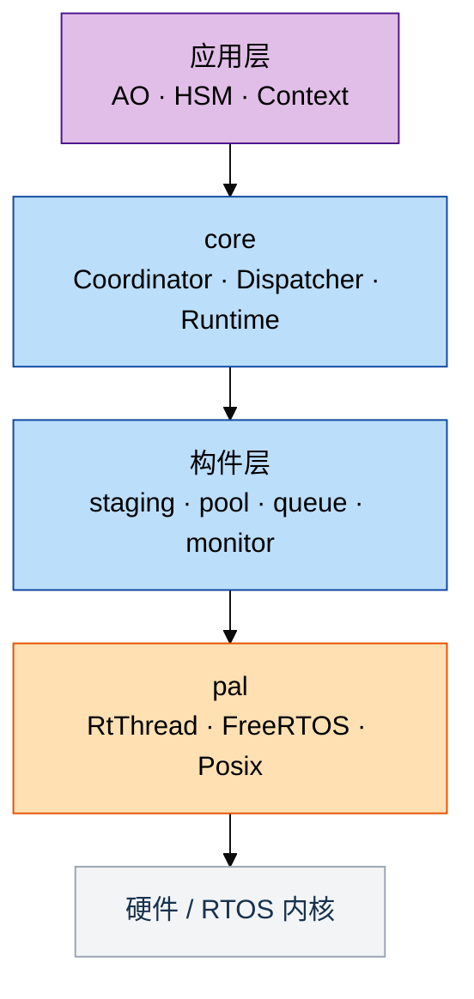

# C++17 与 C 的能力差异、成本与使用边界

结论：C 能实现 coact 的全部功能。差别在约束的执行者：C 把容量关系、资源所有
权、类型区分和清理配对写在注释、命名前缀和评审清单里，由人执行；C++17 把其中一
部分写进类型系统和编译期断言，由编译器执行。coact 的 `include/` 目录下有 81 处
`static_assert`、66 处 `= delete`、44 处 `[[nodiscard]]`（按文本行统计），另有
模板容量参数、强类型句柄和 RAII 清理。成本按等价功能口径为 Flash 多 1 至 2
KiB、RAM 大致持平，实测数据见第 4 节。

## 1. C 语言层面表达不出来的约束

下表六项在 C 里没有对应的语言表达，只能由注释和评审维持。路径均相对
`include/coact/`。

| 约束 | C 的替代手段 | 失效方式 | 位置 |
|---|---|---|---|
| 资源不可复制、不可移动 | 注释加评审 | 结构体被赋值或 `memcpy` 后出现两份状态 | `coordinator.hpp:57`、`reg_cache.hpp:148`、`admission.hpp:273` |
| 作用域退出必然清理 | `goto cleanup`，逐个 `return` 手写 | 新增提前返回时漏掉一次释放 | `pal.hpp:35`、`pal_freertos.hpp:358`、`reg_cache.hpp:141` |
| 句柄与枚举不可互换 | `typedef` 加命名前缀 | `enum` 与 `int` 双向隐式转换，实参错位不报错 | `config.hpp:17`、`config.hpp:55` |
| 容量与类型作编译期参数 | 宏展开，或每种容量手写一份 | 容量关系只写在注释里，改一处漏一处 | `pool.hpp:341`、`staging.hpp:197`、`runtime.hpp:82` |
| 关闭即零存储 | `#ifdef` 或运行期分支 | 字段与代码仍然占空间 | `monitor.hpp:774`、`monitor.hpp:786`、`admission.hpp:374` |
| 接口契约与平台前提检查 | 函数指针表加 `void*` 上下文 | 上下文类型丢失，Profile 与 lock-free 前提无处检查 | `pool.hpp:341`、`ao.hpp:69`、`hsm.hpp:30` |

`DispatchCoordinator` 删除拷贝构造，注释写明了复制的后果：

```cpp
/* Copying would give two coordinators separate admission gates over the
   same staging queue, so the interval rule could be bypassed by
   alternating submit calls between the copies. */
DispatchCoordinator(const DispatchCoordinator&) = delete;
DispatchCoordinator& operator=(const DispatchCoordinator&) = delete;
```

清理配对用 guard 封装，析构在任何退出路径执行，包含提前返回。提交路径返回八种
结果码，其中五种是丢弃或拒绝（`config.hpp:71`），每个分支都需要成对释放：

```cpp
class BypassGuard {
 public:
  explicit BypassGuard(PeriphRegCache& c) noexcept : c_(c) { c_.cache_bypass = true; }
  ~BypassGuard() {
    c_.cache_bypass = false;
    c_.resync_from_hw();  // exit = align, always
  }
  BypassGuard(const BypassGuard&) = delete;
  BypassGuard(BypassGuard&&) = delete;
  // ...
};
```

同类 guard 还有 `CriticalSectionGuard`（`pal.hpp:35`）与 FreeRTOS PAL 的
`SemGuard`、`MutexGuard`、`CondGuard`、`SoftIrqGuard`
（`pal_freertos.hpp:358`、`:374`、`:390`、`:406`）。

强类型句柄的开销可以用断言证明为零：

```cpp
struct TargetId {
  uint8_t value = 0U;
  constexpr TargetId() noexcept = default;
  constexpr explicit TargetId(uint8_t v) noexcept : value(v) {}
  constexpr uint8_t raw() const noexcept { return value; }
  constexpr bool operator==(TargetId o) const noexcept { return value == o.value; }
  constexpr bool operator!=(TargetId o) const noexcept { return value != o.value; }
};
inline constexpr TargetId kInvalidTarget(0U);
static_assert(sizeof(TargetId) == 1U, "coact: TargetId must be zero-overhead");
```

容量与类型作为模板参数时，参数之间的关系可以同时被断言约束：

```cpp
static_assert(Capacity > 0U, "EventPool requires a non-zero capacity");
static_assert(Capacity < 0xFFFFU, "EventPool capacity must fit the 16-bit free-list index");
static_assert(BlockSize >= sizeof(Event), "EventPool block must fit an Event");
static_assert(BlockAlign >= alignof(Event), "EventPool block alignment must cover Event alignment");
static_assert(detail::pool_block_align<BlockAlign>(BlockSize) <= 0xFFFFU, "aligned block stride must fit uint16_t");
```

`pool.hpp:341` 起共 9 条，覆盖 Profile 合法性、容量、块大小与对齐。
`staging.hpp:197` 起覆盖预留不超过分区容量、老化上限低于 32 位 ns 差值、原子必
须 lock-free；`staging.hpp:94` 约束槽位布局不得增长。

关闭的功能用全特化实现零存储，并用 `is_empty` 断言固定：

```cpp
template <>
class AdmissionSnapshotRing<0U> {
 public:
  static constexpr uint8_t kSlots = 0U;
  void record(TargetId, SubmitDisposition, uint16_t, uint64_t, uint64_t) const noexcept {}
  uint64_t count() const noexcept { return 0U; }
  // ...
};

static_assert(std::is_empty<AdmissionSnapshotRing<0U>>::value,
              "coact: a disabled snapshot ring must not occupy storage");
```

这里要区分两种零成本：关闭准入策略时代码路径编译为空（`admission.hpp:374` 的
`NoAdmission`），启用快照环则要付 RAM。

接口契约检查还包含 HSM 钩子签名：`bool (*guard)(const Context&, const Event&)`
与 `void (*action)(Context&, const Event&)`（`hsm.hpp:30`），`Context` 参与签
名，传错上下文类型在编译期失败。C 的等价写法是 `void (*)(void* ctx, ...)` 加一
次手动 cast。平台前提用 `is_same` 与 `is_always_lock_free` 断言
（`pool.hpp:341`、`ao.hpp:69`），目标端不支持 lock-free 时构建失败，而不是运行
期出现竞态。

两项不计入本节：C11 的 `_Static_assert` 能覆盖其中一部分断言，例如槽位大小；配
置层面的 16 个 `#error`（`pal_freertos.hpp:34` 至 `:123`）用预处理器实现，C 同
样可用。

## 2. C 能实现但成本更高的部分

| 事项 | C 的做法 | coact 的做法 | 差别 |
|---|---|---|---|
| 错误路径释放 | `goto` 阶梯，逐分支手写 | RAII guard | 提前返回数量增加时，漏释放的位置随之增加 |
| 定容容器 | 每类型一份或宏展开 | 一份模板加断言 | `BoundedMpscQueue`、`SingleCoreCriticalRing`、`SpscRing`、`EventPool` 共享同一套所有权与容量约束 |
| 配置裁剪 | `#define` 与 `#ifdef` 分散 | `Config` 结构体加模板参数 | 容量、预算、策略集中在一个类型里，链接前可核算 |
| 平台适配 | 条件编译，每平台一份适配 | PAL 与 Profile 作为模板参数 | host 与目标共用同一套头文件 |
| 未检查返回值 | 评审，或逐个函数加编译器属性 | `[[nodiscard]]` 与 `Expected<V, E>` | `expected.hpp:22` 的 `Expected` 类本身标 `[[nodiscard]]` |
| 指针加长度 | 两个参数，可能不匹配 | `Span<T>`（`span.hpp:19`） | 长度与指针绑定，边界检查集中一处 |
| 符号命名 | `coact_` 前缀纪律 | `namespace` | 前缀漏写与链接期冲突只能靠评审发现 |
| 同名不同参 | `submit_u8`、`submit_u16` 或宏 | 重载 | 调用方不需要记后缀 |
| 编译期计算 | 宏，或运行期算一遍 | `constexpr` 函数与 `constexpr` 表 | 转移表是源码里的普通表，同一份代码可在编译期求值 |
| 单元测试 | `static` 函数需 include `.c` 或加钩子 | 头文件模板直接在 host 编译 | 39 个测试翻译单元在开发机上运行，覆盖 AO、HSM、准入与熔断 |

## 3. C++ 不占优势的部分

- 寄存器读写、启动代码、中断向量表、链接脚本：用 C 或汇编。coact 的裸机夹具
  `test/renode/start.c`、`test/renode/runtime.c` 是 C。
- BSP 与第三方驱动：保持 C 接口。coact 只在 PAL 边界封装，不要求为了用 C++ 重
  写驱动。
- 异常、RTTI、`iostream`、`std::function`、`shared_ptr`、动态容器：禁用，由编
  译选项与规范门禁挡住。
- 热路径虚函数、深模板递归、64 位软件除法：避免。`AoBase` 只保留一层受控虚调
  用，其余用模板绑定。
- Flash 预算低于约 64 KiB 且不需要 AO 与 HSM 的极小固件：用 C 更划算。
- 只有三五个任务、逻辑以顺序流程为主的系统：不需要 AO 与 HSM 结构。

## 4. 体积与 RAM

同一 FreeRTOS 内核、启动代码、链接脚本与 `-Os`，
`configSUPPORT_DYNAMIC_ALLOCATION=0`、`configTOTAL_HEAP_SIZE=0`，由
`test/renode/footprint.sh` 实测：

| 镜像 | text | data | bss | 相对基线 Flash | 相对基线 RAM |
|---|---:|---:|---:|---:|---:|
| 裸 FreeRTOS 基线 | 6624 | 8 | 3128 | 0 | 0 |
| coact 默认配置 | 15620 | 12 | 12608 | +8.8 KiB | +9.3 KiB |
| coact 小配置 + LTO | 14868 | 12 | 9568 | +7.9 KiB | +6.3 KiB |

RAM 的两个主要项是 Dispatcher 栈 4 KiB 与 Staging 三分区槽位（默认 High 32、
Normal 64、Low 128，每槽 12 字节）。这两项由容量配置决定，与语言无关，C 版同样
需要。

与 C 的对比目前是估算：等价功能的 C 实现预计增加 5 至 7 KiB Flash、6 至 10 KiB
RAM；按同一功能口径，coact 小配置的差额为 Flash +1 至 2 KiB、RAM 0 至 1 KiB，
主要来自模板实例化与通用装配。极简 C（一个任务、一个环形队列、`switch` 状态
机）预计 2 至 3.5 KiB 与 4 至 5 KiB，但没有 AO 注册表、熔断、准入和同等监控，
属于功能差异而非语言差异。

表述边界：可以说成本有界、可配置、无堆；不能说不会增大固件，也不能说和 C 一样
大。要把估算变成结论，需用同一工具链和链接脚本再构建一个 C 参考镜像，
`footprint.sh` 已具备多镜像对比能力。

## 5. 编码规范与检查器

采用的子集是明确的：C++17、`-fno-exceptions -fno-rtti`、
`-Wall -Wextra -Wpedantic`（`CMakeLists.txt:31`）、无 `new/delete`、无堆、静态
分配、无运行期建表、无动态注册。

本地复跑 `clang-tidy`（LLVM 22.1.8，`--checks='-*,autosar-*,cert-*'`）：

| 翻译单元 | AUTOSAR 与 CERT 告警 | 说明 |
|---|---:|---|
| `src/core/pal_freertos.cpp` | 0 | 生产 PAL |
| `src/core/pal_posix.cpp` | 0 | host PAL |
| `src/core/bench_hotpath.cpp` | 13 | host 基准工具，`atoi`、`atof` 与忽略返回值，不进目标镜像 |
| `src/core/pal_rtthread.cpp`、`pal_windows.cpp`、`rtt_compile_gate.cpp` | 无法检查 | 本机缺 `rthw.h`、`windows.h`，需要在 CI 补交叉编译 job |

MISRA 方面的三点立场：MISRA C 的检查器生态更成熟，这是事实；生产 PAL 按 MISRA
C++:2008 的可落地子集编写并记录偏差（无动态分配、无异常、无 RTTI、无虚函数、无
`goto`、无递归、无 C 风格转换，关键不变量用 `static_assert` 固化），偏差与适用
范围见 `docs/misra-cpp-scope.md`，不宣称整个仓库或第三方内核通过认证；语言不是
认证对象，禁用异常、RTTI 与堆之后，coact 没有隐藏控制流、没有动态分配、没有运
行期建表，认证仍需要 HARA、安全目标、故障注入和覆盖率。

对评审的直接作用是可验证性：`static_assert` 是可以在评审现场指认的需求实现证
据，不依赖运行数据；第 1 节的约束由编译器执行，不依赖评审记录是否存在。

## 6. 平台适配

一套头文件，四个 PAL（RT-Thread、FreeRTOS、Posix、Windows），差异收敛在一个模
板参数上：



C 的等价做法是 `#ifdef` 分散在各模块，或每个平台维护一份适配层，跨平台一致性靠
人工比对。coact 的新平台接入面是一个 PAL 类型（线程、信号量、互斥量、条件变
量、软中断、临界区），核心不动；host 与目标跑同一套逻辑，因此第 2 节最后一行的
39 个测试翻译单元可以在开发机上运行。

框架是 header-first，没有代码生成器，也没有运行期建表。不用的模块不实例化就不
进镜像；替换平台只需要换 PAL 类型与 `Config`，业务代码不动。

## 7. 采用条件

建议全部满足再在项目里用 C++17：

1. 工具链：目标平台的 g++ 支持 `-std=c++17`，含 freestanding 头或所需的 C++ 标
   准库。
2. CI：有目标架构交叉编译 job，能编译 PAL 目标路径与 `#error` 门禁。这是当前缺
   口。
3. 编译选项：`-fno-exceptions -fno-rtti -Wall -Wextra -Wpedantic`，禁止
   `new/delete`。
4. 检查器：`clang-tidy` 的 AUTOSAR 与 CERT 检查，或商业 MISRA C++ 检查器进
   CI，偏差有记录。
5. 体积门禁：每次合并跑 `size` 对比，新增模板实例要能解释增量。
6. 评审能力：至少两名评审能读模板签名与 `constexpr` 表。coact 只用一层模板参数
   与 `constexpr` 表，没有递归元编程，断言带自定义文本，报错落在断言上而不是模
   板栈；GDB、map、`size`、`objdump` 的用法与 C 相同。

任一条不满足，先在非安全关键模块试点，或继续用 C。

## 附录：允许与禁用的设施

| 允许 | 禁用 |
|---|---|
| `enum class`、强类型句柄、`constexpr` 表与函数 | 异常、RTTI |
| `std::array`、`std::atomic`、`Span`、`string_view` | `new/delete`、任何堆分配 |
| 模板参数化容量与策略、全特化裁剪 | `iostream`、`std::function`、`shared_ptr` |
| RAII guard、`[[nodiscard]]`、`Expected<V, E>` | 动态容器（`vector`、`map`、`string`） |
| 命名空间、重载、`static_assert` | 热路径虚函数、深模板递归、64 位软件除法 |
| 冷路径标准算法（`std::sort`、`std::transform`） | 运行期建表、动态注册 |

一句话：C 能实现功能等价的 coact，但不能在语言层面表达第 1 节表格里的六项约
束，这些约束在 C 里由注释和评审维持。C++17 的成本是 Flash 多 1 至 2 KiB 和一份
需要门禁的使用规范。
