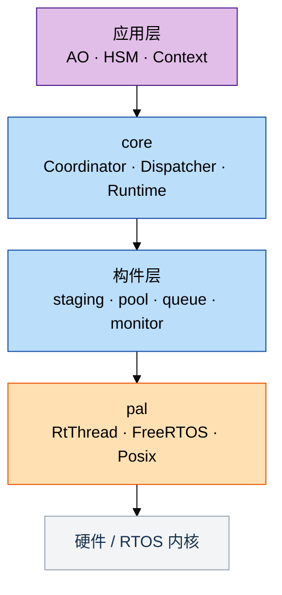

# C++17 与 C 的能力差异、成本与使用边界

coact 是一个 C++17 事件框架，目标平台是单核 MCU 上的 RT-Thread 与 FreeRTOS；同一套头文件通过 Posix 与 Windows 实现也能在 PC 上编译，用于测试。它不使用堆、异常和 RTTI，也没有代码生成器。本文比较同一套功能用 C++17 与用 C 写出来的差别，以及这套写法的 Flash 与 RAM 代价。

## 0. 前置事实

### 0.1 设计取向

事件框架通常用解耦和吸收突起来解释自己：生产者不必等消费者，突发先落在队列里。这两个词说的是功能和吞吐，没有回答功能安全的三个问题：最坏情况有多大、出了问题能否看见、出了问题能否回到确定状态。coact 的结构围绕后三点安排：

| 性质 | 机制 | 判断依据 |
|---|---|---|
| 有界 | 队列、事件池与分区容量是编译期常量，提交前先过准入判定；不用堆，没有 `new/delete` 与动态注册 | 最坏内存占用与最坏执行路径在链接时可核算，不存在分配失败分支 |
| 可检测 | 每次提交返回结果码；准入拒绝、熔断级别、分区水位与丢弃计数可由 Monitor 读出；不变量被破坏时走 fatal handler，不静默继续 | 失效在发生点可见，能定位到具体 AO 与分区 |
| 可恢复 | 每个 AO 一份熔断状态机：Normal、BrokenL1、BrokenL2、Safe、Recovering 逐级转换；AO 的状态与转移是常量表 | 恢复要求冷却到期、水位持续低、受控探测成功、连续健康窗口足够，单次成功不算恢复 |

三条各有两侧：库内机制与 BSP 证据源。有界的容量、批大小和预算全在库内；可检测的一半在库内（结果码、计数、fatal handler），另一半是事件源，即分区水位、worker 进度和预留耗尽，由 BSP 采样后调用 `BreakerBank` 的对应入口；可恢复的状态机与判定条件在库内，恢复的两个入口（安全恢复信号、受控探测结果）同样由 BSP 触发。`examples/safety_supervisor_demo.cpp` 是这套接线的可运行版本，主机上自校验，覆盖从 L2、Safe 到 Recovering、Normal 的完整来回。

执行顺序可复现是这三条的前提：全部 AO 由唯一的 dispatcher 驱动，事件走定长分区队列，不按需创建任务，同一输入序列的执行顺序在构建时就固定。

### 0.2 术语

| 名称 | 在本仓库中的含义 |
|---|---|
| AO（Active Object） | 有独立状态机、同一时刻只允许一个执行体在跑的执行实体，事件按 TargetId 路由 |
| HSM（Hierarchical State Machine） | 层次状态机，转移表写成 `constexpr` 常量数组，含进入、退出、保护与动作 |
| TargetId | AO 的编号，从 1 开始，0 表示未绑定；实现上是 8 位无符号整数的强类型包装 |
| PriorityClass | AO 的固定优先级分类：High、Normal、Low，决定事件进入哪个分区 |
| Coordinator | 提交管线：准入判定、分区选择、结果码返回 |
| Dispatcher | 唯一的调度线程，按分区顺序取事件并驱动 AO |
| Staging | 三个定长分区队列，容量在编译期给定；Low 分区有老化上限，避免饥饿 |
| Admission | 准入策略，例如同一 AO 的最小提交间隔与分区容量预留；可选，关闭后不占存储 |
| Config | 一个集中声明容量、预算与策略的类型，作为模板参数传进各构件 |
| Profile | 平台能力描述，例如原子操作是否 lock-free，由编译期断言检查 |
| Breaker | 每个 AO 一份的熔断状态机：过载逐级降级到 Safe，满足恢复条件后回到 Normal |
| Monitor | 运行期诊断：分区水位、丢弃计数、准入快照，容量为 0 时不占存储 |
| PAL | Platform Abstraction Layer，把线程、信号量、互斥量、条件变量、软中断、临界区收进一层薄封装，RT-Thread 与 FreeRTOS 各一份实现 |
| 构件（blocks） | `EventPool` 定长事件池、`SpscRing` 单生产者单消费者环、`BoundedMpscQueue` 有界多生产者队列、`SingleCoreCriticalRing` 临界区保护的单核环 |

## 1. C 语言层面表达不出来的约束

先看一处可复现的差异。`Staging::enqueue` 的实参是 `(TargetId, Event*, PriorityClass, uint64_t)`，`TargetId` 与 `PriorityClass` 在目标端都是 8 位。C 的等价签名是 `staging_enqueue(uint8_t target, Event *e, uint8_t cls, uint64_t now_ns)`，把 target 与 cls 传反，`gcc -std=c11 -Wall -Wextra` 不报错；coact 的签名下同样的调用无法编译：

```text
error: could not convert 'coact::PriorityClass::High' from
'coact::PriorityClass' to 'coact::TargetId'
```

两种写法生成的目标代码相同，`TargetId` 的布局由 `static_assert(sizeof(TargetId) == 1U)` 固定；区别只在传错实参时由谁发现。下表把这类差异按约束类型列出。

| 约束 | C 的替代手段 | 失效方式 | 相关类型 |
|---|---|---|---|
| 资源不可复制、不可移动 | 注释加评审 | 结构体被赋值或 `memcpy` 后出现两份状态 | `DispatchCoordinator`、`PeriphRegCache`、`ArrivalReservation` |
| 作用域退出必然清理 | `goto cleanup`，逐个 `return` 手写 | 新增提前返回时漏掉一次释放 | `BypassGuard`、`CriticalSectionGuard`、FreeRTOS PAL 的 `SemGuard` 等 |
| 句柄与枚举不可互换 | `typedef` 加命名前缀 | `enum` 与 `int` 双向隐式转换，实参错位不报错 | `PriorityClass`、`TargetId` |
| 容量与类型作编译期参数 | 宏展开，或每种容量手写一份 | 容量关系只写在注释里，改一处漏一处 | `EventPool`、`Staging`、`Runtime` |
| 关闭即零存储 | `#ifdef` 或运行期分支 | 字段与代码仍然占空间 | `Monitor`、`AdmissionSnapshotRing<0>`、`NoAdmission` |
| 接口契约与平台前提检查 | 函数指针表加 `void*` 上下文 | 上下文类型丢失，Profile 与 lock-free 前提无处检查 | `EventPool`、`PendingCounter`、`TransitionDef` |

表格第一行落到代码上就是两条删除声明。`DispatchCoordinator` 禁止拷贝，注释写明了复制的后果：

```cpp
/* Copying would give two coordinators separate admission gates over the
   same staging queue, so the interval rule could be bypassed by
   alternating submit calls between the copies. */
DispatchCoordinator(const DispatchCoordinator&) = delete;
DispatchCoordinator& operator=(const DispatchCoordinator&) = delete;
```

第二行（作用域退出必然清理）用 guard 封装，析构在每条退出路径上都执行。`PeriphRegCache` 是外设寄存器的影子缓存，写硬件期间置 `cache_bypass`，退出时必须关掉旁路并从硬件重新同步；提前返回也跳不过这一步：

```cpp
class BypassGuard {
 public:
  explicit BypassGuard(PeriphRegCache& c) noexcept : c_(c) { c_.cache_bypass = true; }
  ~BypassGuard() {
    c_.cache_bypass = false;
    c_.resync_from_hw();  // exit = align, always
  }
  BypassGuard(const BypassGuard&) = delete;
  BypassGuard(BypassGuard&&) = delete;
  // ...
};
```

提交管线同理：`SubmitResult` 有八种结果码，其中五种是丢弃或拒绝，每条分支都要把事件或预留还回去，漏一处就是泄漏。

同类 guard 还有 `CriticalSectionGuard`，以及 FreeRTOS PAL 的 `SemGuard`、`MutexGuard`、`CondGuard`、`SoftIrqGuard`。

强类型句柄的开销可以用断言证明为零：

```cpp
struct TargetId {
  uint8_t value = 0U;
  constexpr TargetId() noexcept = default;
  constexpr explicit TargetId(uint8_t v) noexcept : value(v) {}
  constexpr uint8_t raw() const noexcept { return value; }
  constexpr bool operator==(TargetId o) const noexcept { return value == o.value; }
  constexpr bool operator!=(TargetId o) const noexcept { return value != o.value; }
};
inline constexpr TargetId kInvalidTarget(0U);
static_assert(sizeof(TargetId) == 1U, "coact: TargetId must be zero-overhead");
```

容量与类型作为模板参数时，参数之间的关系可以同时被断言约束：

```cpp
static_assert(Capacity > 0U, "EventPool requires a non-zero capacity");
static_assert(Capacity < 0xFFFFU, "EventPool capacity must fit the 16-bit free-list index");
static_assert(BlockSize >= sizeof(Event), "EventPool block must fit an Event");
static_assert(BlockAlign >= alignof(Event), "EventPool block alignment must cover Event alignment");
static_assert(detail::pool_block_align<BlockAlign>(BlockSize) <= 0xFFFFU, "aligned block stride must fit uint16_t");
```

`EventPool` 的编译期断言共 9 条，覆盖 Profile 合法性、容量、块大小与对齐；`Staging` 的断言覆盖预留不超过分区容量、老化上限低于 32 位 ns 差值、原子必须 lock-free，`StagingSlot` 另有布局不得增长的约束。

关闭的功能用全特化实现零存储，并用 `is_empty` 断言固定：

```cpp
template <>
class AdmissionSnapshotRing<0U> {
 public:
  static constexpr uint8_t kSlots = 0U;
  void record(TargetId, SubmitDisposition, uint16_t, uint64_t, uint64_t) const noexcept {}
  uint64_t count() const noexcept { return 0U; }
  // ...
};

static_assert(std::is_empty<AdmissionSnapshotRing<0U>>::value,
              "coact: a disabled snapshot ring must not occupy storage");
```

这里要区分两种零成本：关闭准入策略时代码路径编译为空（`NoAdmission` 全特化），启用准入快照环（`AdmissionSnapshotRing`）则要付 RAM。

接口契约检查还包含 HSM 钩子签名：`TransitionDef` 的 `bool (*guard)(const Context&, const Event&)` 与 `void (*action)(Context&, const Event&)`，`Context` 参与签名，传错上下文类型在编译期失败。C 的等价写法是 `void (*)(void* ctx, ...)` 加一次手动 cast。平台前提用 `is_same` 与 `is_always_lock_free` 断言（`EventPool`、`PendingCounter`），目标端不支持 lock-free 时构建失败，而不是运行期出现竞态。

规模上，`include/` 目录现有 `static_assert` 81 处、`= delete` 66 处、`[[nodiscard]]` 44 处（按文本行统计），本节只展开其中构成资源、容量与平台前提约束的部分。

两项不计入本节：C11 的 `_Static_assert` 能覆盖其中一部分断言，例如槽位大小；FreeRTOS PAL 配置层面的 `#error` 门禁用预处理器实现，C 同样可用。

## 2. C 能实现但成本更高的部分

| 事项 | C 的做法 | coact 的做法 | 差别 |
|---|---|---|---|
| 错误路径释放 | `goto` 阶梯，逐分支手写 | RAII guard | 提前返回数量增加时，漏释放的位置随之增加 |
| 定容容器 | 每类型一份或宏展开 | 一份模板加断言 | `BoundedMpscQueue`、`SingleCoreCriticalRing`、`SpscRing`、`EventPool` 共享同一套所有权与容量约束 |
| 配置裁剪 | `#define` 与 `#ifdef` 分散 | `Config` 结构体加模板参数 | 容量、预算、策略集中在一个类型里，链接前可核算 |
| 平台适配 | 条件编译，每平台一份适配 | PAL 与 Profile 作为模板参数 | host 与目标共用同一套头文件 |
| 未检查返回值 | 评审，或逐个函数加编译器属性 | `[[nodiscard]]` 与 `Expected<V, E>` | `Expected` 类本身标 `[[nodiscard]]` |
| 指针加长度 | 两个参数，可能不匹配 | `Span<T>` | 长度与指针绑定，边界检查集中一处 |
| 符号命名 | `coact_` 前缀纪律 | `namespace` | 前缀漏写与链接期冲突只能靠评审发现 |
| 同名不同参 | `submit_u8`、`submit_u16` 或宏 | 重载 | 调用方不需要记后缀 |
| 编译期计算 | 宏，或运行期算一遍 | `constexpr` 函数与 `constexpr` 表 | 转移表是源码里的普通表，同一份代码可在编译期求值 |
| 单元测试 | `static` 函数需 include `.c` 或加钩子 | 头文件模板直接在 host 编译 | 39 个测试翻译单元在开发机上运行，覆盖 AO、HSM、准入与熔断 |

## 3. C++ 不占优势的部分

加粗的是 C++ 在这些场合的短板，coact 都已经规避；后两条属于不该选 coact 的系统。

- **寄存器读写、启动代码、中断向量表、链接脚本只能用 C 或汇编**；coact 的裸机夹具 `test/renode/start.c`、`test/renode/runtime.c` 就是 C。
- **BSP 与第三方驱动只能用 C 接口**；coact 只在 PAL 边界做薄封装，不要求为了用 C++ 重写驱动。
- **异常、RTTI、`iostream`、`std::function`、`shared_ptr`、动态容器都不能用**；coact 由编译选项与规范门禁全部禁用。
- **热路径虚函数、深模板递归、64 位软件除法的代价过高**；coact 让 AO 的公共基类 `AoBase` 只保留一层受控虚调用，其余用模板绑定。
- Flash 预算低于约 64 KiB 且不需要 AO 与 HSM 的极小固件：用 C 更划算。
- 只有三五个任务、逻辑以顺序流程为主的系统：不需要 AO 与 HSM 结构。

## 4. 体积与 RAM

同一 FreeRTOS 内核、启动代码、链接脚本与 `-Os`，`configSUPPORT_DYNAMIC_ALLOCATION=0`、`configTOTAL_HEAP_SIZE=0`，由 `test/renode/footprint.sh` 实测：

| 镜像 | text | data | bss | 相对基线 Flash | 相对基线 RAM |
|---|---:|---:|---:|---:|---:|
| 裸 FreeRTOS 基线 | 6624 | 8 | 3128 | 0 | 0 |
| coact 默认配置 | 15620 | 12 | 12608 | +8.8 KiB | +9.3 KiB |
| coact 小配置 + LTO | 14868 | 12 | 9568 | +7.9 KiB | +6.3 KiB |

RAM 的两个主要项是 Dispatcher 栈 4 KiB 与 Staging 三分区槽位（默认 High 32、Normal 64、Low 128，每槽 12 字节）。这两项由容量配置决定，与语言无关，C 版同样需要。

与 C 的对比目前是估算：等价功能的 C 实现预计增加 5 至 7 KiB Flash、6 至 10 KiB RAM；按同一功能口径，coact 小配置的差额为 Flash +1 至 2 KiB、RAM 0 至 1 KiB，主要来自模板实例化与通用装配。极简 C（一个任务、一个环形队列、`switch` 状态机）预计 2 至 3.5 KiB 与 4 至 5 KiB，但没有 AO 注册表、熔断、准入和同等监控，属于功能差异而非语言差异。

表述边界：可以说成本有界、可配置、无堆；不能说不会增大固件，也不能说和 C 一样大。要把估算变成结论，需用同一工具链和链接脚本再构建一个 C 参考镜像，`footprint.sh` 已具备多镜像对比能力。

## 5. 编码规范与检查器

采用的子集是明确的：C++17、`-fno-exceptions -fno-rtti`、`-Wall -Wextra -Wpedantic`、无 `new/delete`、无堆、静态分配、无运行期建表、无动态注册。

本地复跑 `clang-tidy`（LLVM 22.1.8，`--checks='-*,autosar-*,cert-*'`）：

| 检查对象 | AUTOSAR 与 CERT 告警 | 说明 |
|---|---:|---|
| FreeRTOS PAL | 0 | 生产代码 |
| POSIX PAL | 0 | host 代码 |
| 热路径基准工具 | 13 | 主机侧工具，`atoi`、`atof` 与忽略返回值，不进目标镜像 |
| RT-Thread PAL、Windows PAL 与编译门禁 | 无法检查 | 本机缺平台头，需要在 CI 补交叉编译 job |

MISRA 方面的三点立场：MISRA C 的检查器生态更成熟，这是事实；生产 PAL 按 MISRA C++:2008（安全相关软件的 C++ 编码规范）的可落地子集编写并记录偏差（无动态分配、无异常、无 RTTI、无虚函数、无 `goto`、无递归、无 C 风格转换，关键不变量用 `static_assert` 固化），偏差与适用范围见 `docs/cpp_coding_conventions_zh.md`，不宣称整个仓库或第三方内核通过认证；语言不是认证对象，禁用异常、RTTI 与堆之后，coact 没有隐藏控制流、没有动态分配、没有运行期建表，认证仍需要 HARA、安全目标（由 HARA 导出、可测量的顶层要求）、故障注入和覆盖率。

对评审的直接作用是可验证性：`static_assert` 是可以在评审现场指认的需求实现证据，不依赖运行数据；第 1 节的约束由编译器执行，不依赖评审记录是否存在。

## 6. 平台适配

一套头文件，四个 PAL（RT-Thread、FreeRTOS、Posix、Windows），差异收敛在一个模板参数上：



C 的等价做法是 `#ifdef` 分散在各模块，或每个平台维护一份适配层，跨平台一致性靠人工比对。coact 的新平台接入面是一个 PAL 类型（线程、信号量、互斥量、条件变量、软中断、临界区），核心不动；host 与目标跑同一套逻辑，因此第 2 节最后一行的 39 个测试翻译单元可以在开发机上运行。

框架是 header-first，没有代码生成器，也没有运行期建表。不用的模块不实例化就不进镜像；替换平台只需要换 PAL 类型与 `Config`，业务代码不动。

## 附录：允许与禁用的设施

| 允许 | 禁用 |
|---|---|
| `enum class`、强类型句柄、`constexpr` 表与函数 | 异常、RTTI |
| `std::array`、`std::atomic`、`Span`、`string_view` | `new/delete`、任何堆分配 |
| 模板参数化容量与策略、全特化裁剪 | `iostream`、`std::function`、`shared_ptr` |
| RAII guard、`[[nodiscard]]`、`Expected<V, E>` | 动态容器（`vector`、`map`、`string`） |
| 命名空间、重载、`static_assert` | 热路径虚函数、深模板递归、64 位软件除法 |
| 冷路径标准算法（`std::sort`、`std::transform`） | 运行期建表、动态注册 |
