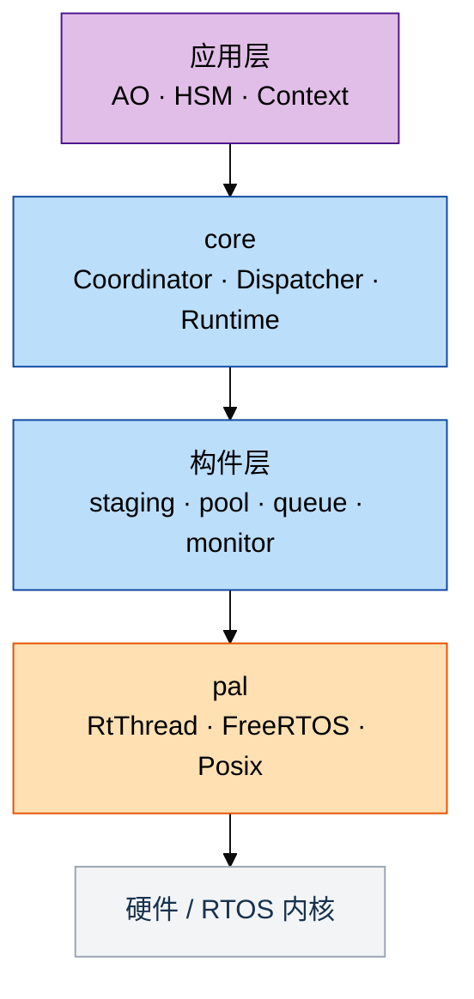

# 为什么用 C++17 而不是 C：一份可反驳的必要性论证

结论先行：C 能实现 coact 的全部功能，这一点没有争议，也不是本文的论点。分歧在
于约束由谁执行。C 把容量关系、资源所有权、类型区分和清理配对写在注释、命名前缀
和评审清单里，由人执行；C++17 把其中一部分写进类型系统和编译期断言，由编译器执
行。coact 仓库里这类约束的规模是 `include/` 下 81 处 `static_assert`、66 处
`= delete`、44 处 `[[nodiscard]]`（按文本行统计），外加模板容量参数、强类型句
柄和 RAII 清理。代价是可测的：按等价功能口径，相对 C 实现 Flash 多 1 至 2
KiB，RAM 大致持平。

本文把主张拆成三类，逐条给出代码位置。凡是能反驳的条目，请直接反驳；A 类条目如
果能在 C 里找到等价的语言级表达，本文的结论就不成立。

| 类别 | 判据 | 结论 |
|---|---|---|
| A 类 | C 语言层面表达不出来，只能靠约定 | 能力差异，无法用纪律补齐 |
| B 类 | C 能表达，但成本或缺陷率明显更高 | 成本差异，可量化比较 |
| C 类 | C++ 没有优势，coact 仍用 C 或 C 接口 | 不主张迁移 |

## 1. A 类：C 表达不出来的六项约束

### 1.1 资源身份不可复制、不可移动

C 里任何 `struct` 都可以被赋值和 `memcpy`，语言层面无法禁止。持有临界区、预
约、旁路状态的结构体一旦被复制，症状是间歇性时序错误，只能靠评审发现。

C++17 用 `= delete` 把复制变成编译错误。coact 在 `DispatchCoordinator` 上写明
了理由：

```cpp
/* Copying would give two coordinators separate admission gates over the
   same staging queue, so the interval rule could be bypassed by
   alternating submit calls between the copies. */
DispatchCoordinator(const DispatchCoordinator&) = delete;
DispatchCoordinator& operator=(const DispatchCoordinator&) = delete;
```

实例位置：`include/coact/coordinator.hpp:57`（准入状态不可复制）、
`include/coact/reg_cache.hpp:148`（`BypassGuard` 同时删除拷贝与移动）、
`include/coact/admission.hpp:273`（`ArrivalReservation` 不可复制）。

C 的等价手段只有注释加评审。这条约束的价值不在于阻止第一次错误，而在于人员流动
后仍然生效。

### 1.2 作用域退出必然清理

C 的清理靠 `goto cleanup` 或每个 `return` 前手写。提交路径返回八种结果码，其中
五种是丢弃或拒绝（`SubmitDisposition`，见 `include/coact/config.hpp:71`），每
增加一个提前返回就多一处可能漏掉的释放。

C++17 的析构函数在任何退出路径上执行，包括提前返回。coact 的临界区、信号量、互
斥量、软中断和寄存器旁路全部用 guard 封装：

```cpp
class BypassGuard {
 public:
  explicit BypassGuard(PeriphRegCache& c) noexcept : c_(c) { c_.cache_bypass = true; }
  ~BypassGuard() {
    c_.cache_bypass = false;
    c_.resync_from_hw();  // exit = align, always
  }
  BypassGuard(const BypassGuard&) = delete;
  BypassGuard(BypassGuard&&) = delete;
  // ...
};
```

实例位置：`include/coact/pal.hpp:35`（`CriticalSectionGuard`）、
`include/coact/pal_freertos.hpp:358/374/390/406`（`SemGuard`、`MutexGuard`、
`CondGuard`、`SoftIrqGuard`）、`include/coact/reg_cache.hpp:141`
（`BypassGuard`）、`include/coact/admission.hpp:184`（准入预约路径上的临界区
guard）。

关中断未恢复、信号量未释放、影子寄存器未回写是现场最难定位的一类问题。RAII 把
“配对”从人工检查变成结构属性。

### 1.3 强类型句柄与不可互换的枚举

C 的 `enum` 与 `int` 双向隐式转换合法，`typedef` 不产生新类型。`TargetId`、逻
辑优先级、分区类别在 C 里可以互相传参而编译器不报错。

coact 用 `enum class` 加显式句柄，并且用断言证明零开销：

```cpp
struct TargetId {
  uint8_t value = 0U;
  constexpr TargetId() noexcept = default;
  constexpr explicit TargetId(uint8_t v) noexcept : value(v) {}
  constexpr uint8_t raw() const noexcept { return value; }
  constexpr bool operator==(TargetId o) const noexcept { return value == o.value; }
  constexpr bool operator!=(TargetId o) const noexcept { return value != o.value; }
};
inline constexpr TargetId kInvalidTarget(0U);
static_assert(sizeof(TargetId) == 1U, "coact: TargetId must be zero-overhead");
```

实例位置：`include/coact/config.hpp:55`（`TargetId`）、
`include/coact/config.hpp:17`（`PriorityClass`）、`include/coact/span.hpp:19`
（`Span<T>` 把指针与长度绑成一个类型）。

关键是最后那条断言：类型安全的代价被证明为一个字节都不增加。“强类型必然更贵”这
个前提在 coact 里不成立。

### 1.4 容量与类型作为编译期参数

C 的替代是宏展开（无类型检查、无作用域、报错信息是展开后的文本）或每种容量手写
一份。coact 用模板参数，并把参数之间的关系写成断言：

```cpp
static_assert(Capacity > 0U, "EventPool requires a non-zero capacity");
static_assert(Capacity < 0xFFFFU, "EventPool capacity must fit the 16-bit free-list index");
static_assert(BlockSize >= sizeof(Event), "EventPool block must fit an Event");
static_assert(BlockAlign >= alignof(Event), "EventPool block alignment must cover Event alignment");
static_assert(detail::pool_block_align<BlockAlign>(BlockSize) <= 0xFFFFU, "aligned block stride must fit uint16_t");
```

实例位置：`include/coact/pool.hpp:341`（Profile 合法性与容量、块大小、对齐共 9
条）、`include/coact/staging.hpp:197`（预留不超过分区容量、老化上限低于 32 位
ns 差值、原子必须 lock-free）、`include/coact/staging.hpp:94`（槽位布局不得增
长）、`include/coact/runtime.hpp:82`（`Runtime<Config, PalT, ...>` 由参数推导
`CoordinatorType`）。

C11 的 `_Static_assert` 能做其中一部分（例如槽位大小）。做不到的是“容量与类型
作为参数参与代码生成，同时被断言约束”这一整套：C 里要么宏，要么复制粘贴。

### 1.5 关闭即零存储

C 用 `#ifdef` 或运行期分支关闭功能，被关掉的结构体字段和代码通常仍然存在。
C++17 用全特化加 `is_empty` 断言证明零存储：

```cpp
template <>
class AdmissionSnapshotRing<0U> {
 public:
  static constexpr uint8_t kSlots = 0U;
  void record(TargetId, SubmitDisposition, uint16_t, uint64_t, uint64_t) const noexcept {}
  uint64_t count() const noexcept { return 0U; }
  // ...
};

static_assert(std::is_empty<AdmissionSnapshotRing<0U>>::value,
              "coact: a disabled snapshot ring must not occupy storage");
```

实例位置：`include/coact/monitor.hpp:774`（零槽特化）、
`include/coact/monitor.hpp:786`（`is_empty` 断言）、
`include/coact/admission.hpp:374`（`NoAdmission` 默认策略）。

这里要区分两种零成本：关闭准入策略时代码路径编译为空，这是零成本；启用快照环就
要付 RAM，那是监控存储成本。把两者混为一谈是文档问题，不是语言问题。

### 1.6 编译期接口契约检查

C 的函数指针表可以检查签名，但上下文只能是 `void*`，也无法检查“这个平台是否满
足必需能力”。coact 把这类前提写成断言与类型约束：

```cpp
static_assert(std::is_same<Profile, RttSingleCoreProfile>::value || std::is_same<Profile, HostSmpProfile>::value,
              "coact: unknown pool synchronization profile (design 7.4)");
static_assert(!std::is_same<Profile, HostSmpProfile>::value || std::atomic<uint32_t>::is_always_lock_free,
              "coact: HostSmpProfile requires a lock-free 32-bit CAS (design 13.1)");
static_assert(std::atomic<uint16_t>::is_always_lock_free, "PendingCounter requires lock-free atomic<uint16_t>");
```

实例位置：`include/coact/pool.hpp:341`、`include/coact/ao.hpp:69`。HSM 的钩子
签名同样带类型：`bool (*guard)(const Context&, const Event&)` 与
`void (*action)(Context&, const Event&)`（`include/coact/hsm.hpp:30`），
`Context` 参与签名，传错上下文类型在编译期失败；C 的等价写法是
`void (*)(void* ctx, ...)` 加一次手动 cast。

配置层面的门禁（16 个 `#error`，`include/coact/pal_freertos.hpp:34` 至
`:123`）用的是预处理器，C 也能做，这一部分不计入 A 类。

## 2. B 类：C 能做，但更贵或更易错

| 事项 | C 的做法 | coact 的做法 | 差别 |
|---|---|---|---|
| 错误路径释放 | `goto` 阶梯，逐分支手写 | RAII guard | 提前返回越多，漏释放概率越高；提交路径有八种结果码分支 |
| 定容容器 | 每类型一份或宏展开 | 一份模板加断言 | `BoundedMpscQueue`、`SingleCoreCriticalRing`、`SpscRing`、`EventPool` 共享同一套所有权与容量约束 |
| 配置裁剪 | `#define` 与 `#ifdef` 分散 | `Config` 结构体加模板参数 | 容量、预算、策略集中在一个类型里，链接前可核算 |
| 平台适配 | 条件编译，每平台一份适配 | PAL 与 Profile 作为模板参数 | host 与目标共用同一套头文件，39 个测试翻译单元在开发机上运行 |
| 未检查返回值 | 评审，或逐个函数加编译器属性 | `[[nodiscard]]` 与 `Expected<V, E>` | `include/coact/expected.hpp:22` 的 `Expected` 类本身标 `[[nodiscard]]`，忽略结果即告警 |
| 指针加长度 | 两个参数，可能不匹配 | `Span<T>` | 长度与指针绑定，边界检查集中一处 |
| 符号命名 | `coact_` 前缀纪律 | `namespace` | 前缀漏写与链接期冲突在 C 里只能靠评审 |
| 同名不同参 | `submit_u8` / `submit_u16` 或宏 | 重载 | 调用方不需要记后缀 |
| 编译期计算 | 宏，或运行期算一遍 | `constexpr` 函数与 `constexpr` 表 | 转移表是源码里的普通表，同一份代码可在编译期求值 |

B 类的每一项都可以用 C 补齐，也都有项目补齐过。差别是补齐的工作量在每次重构、
每次新增模块、每次人员交接时重复支付。

## 3. C 类：C++ 没有优势的地方

- 寄存器读写、启动代码、中断向量表、链接脚本：用 C 或汇编。coact 的裸机夹具
  `test/renode/start.c`、`runtime.c` 就是 C。
- BSP 与第三方驱动：保持 C 接口。coact 只在 PAL 边界封装，不要求为了用 C++ 重
  写驱动。
- 异常、RTTI、`iostream`、`std::function`、`shared_ptr`、动态容器：禁用，由编
  译选项与规范门禁挡住。
- 热路径虚函数、深模板递归、64 位软件除法：避免。`AoBase` 只保留一层受控虚调
  用，其余用模板绑定。
- Flash 预算低于约 64 KiB 且不需要 AO 与 HSM 的极小固件：用 C 更划算。
- 团队读不了模板签名、且没有检查器与体积门禁：先用 C，等门禁到位再迁移。

## 4. 成本：把“C++ 更占资源”变成可测命题

同一 FreeRTOS 内核、启动代码、链接脚本与 `-Os`，
`configSUPPORT_DYNAMIC_ALLOCATION=0`、`configTOTAL_HEAP_SIZE=0`，实测
（`test/renode/footprint.sh`）：

| 镜像 | text | data | bss | 相对基线 Flash | 相对基线 RAM |
|---|---:|---:|---:|---:|---:|
| 裸 FreeRTOS 基线 | 6624 | 8 | 3128 | 0 | 0 |
| coact 默认配置 | 15620 | 12 | 12608 | +8.8 KiB | +9.3 KiB |
| coact 小配置 + LTO | 14868 | 12 | 9568 | +7.9 KiB | +6.3 KiB |

RAM 的两个主要项是 Dispatcher 栈 4 KiB 与 Staging 三分区槽位（默认 High 32 /
Normal 64 / Low 128，每槽 12 字节）。这两项由容量配置决定，与语言无关，C 版同
样需要。

与 C 的对比目前只能是估算：等价功能的 C 实现预计增加 5 至 7 KiB Flash、6 至 10
KiB RAM；按同一功能口径，coact 小配置的差额为 Flash +1 至 2 KiB、RAM 0 至 1
KiB，主要来自模板实例化与通用装配。极简 C（一个任务、一个环形队列、`switch` 状
态机）预计 2 至 3.5 KiB / 4 至 5 KiB，但没有 AO 注册表、熔断、准入和同等监控，
属于功能差异而非语言差异。

表述边界：可以说成本有界、可配置、无堆；不能说不会增大固件，也不能说和 C 一样
大。要把估算变成结论，用同一工具链和链接脚本再构建一个 C 参考镜像，
`footprint.sh` 已经具备多镜像对比能力。

## 5. 规范与功能安全视角

coact 采用的子集是明确的：C++17、`-fno-exceptions -fno-rtti`、
`-Wall -Wextra -Wpedantic`（`CMakeLists.txt:31`）、无 `new` / `delete`、无堆、
静态分配、无运行期建表、无动态注册。

本地复跑 `clang-tidy`（LLVM 22.1.8，`--checks='-*,autosar-*,cert-*'`）的结果：

| 翻译单元 | AUTOSAR / CERT 告警 | 说明 |
|---|---:|---|
| `src/core/pal_freertos.cpp` | 0 | 生产 PAL |
| `src/core/pal_posix.cpp` | 0 | host PAL |
| `src/core/bench_hotpath.cpp` | 13 | host 基准工具，`atoi` / `atof` 与忽略返回值，不进目标镜像 |
| `src/core/pal_rtthread.cpp`、`pal_windows.cpp`、`rtt_compile_gate.cpp` | 无法检查 | 本机缺 `rthw.h`、`windows.h`，需要在 CI 补交叉编译 job |

MISRA 方面的立场分三点：

1. MISRA C 的检查器生态更成熟，这是事实，不回避。
2. 生产 PAL 按 MISRA C++:2008 的可落地子集编写并记录偏差（无动态分配、无异常、
   无 RTTI、无虚函数、无 `goto`、无递归、无 C 风格转换、关键不变量用
   `static_assert` 固化）。偏差与适用范围另有专文，不宣称整个仓库或第三方内核
   通过认证。
3. 语言不是认证对象。禁用异常、RTTI 与堆之后，coact 没有隐藏控制流、没有动态分
   配、没有运行期建表，可分析性与 C 接近。认证仍然需要 HARA、安全目标、故障注
   入和覆盖率，这些不因语言而省。

对功能安全的实际收益集中在可验证性：81 处 `static_assert` 是可以在评审现场直接
指认的需求实现证据，不需要运行数据支撑；A 类约束在人员流动后仍然生效，不依赖
“当时评审过”。

## 6. 平台化架构

一套头文件，四个 PAL（RT-Thread、FreeRTOS、Posix、Windows），差异收敛在一个模
板参数上：



C 的等价做法是 `#ifdef` 分散在各模块，或每个平台维护一份适配层，跨平台一致性靠
人工比对。coact 的新平台接入面是一个 PAL 类型（线程、信号量、互斥量、条件变
量、软中断、临界区），核心不动；host 与目标跑同一套逻辑，因此 39 个测试翻译单
元可以在开发机上覆盖 AO、HSM、准入和熔断。

这一条属于 B 类：C 能做，但每次加平台都要重新做一遍一致性核对。

## 7. 反对意见与回应

| 反对意见 | 回应 |
|---|---|
| C 也能开发出同样的功能 | 同意，功能等价不是分歧点。分歧是 A 类约束由谁执行；B 类是成本差，可量化；A 类无法用纪律补齐 |
| C++ 固件更大 | 等价功能口径 Flash 多 1 至 2 KiB，主要成本是栈与队列容量，C 版同样需要。数字来自实测，估算部分已标注 |
| 模板报错看不懂、调试难 | coact 只用一层模板参数与 `constexpr` 表，没有递归元编程；断言带自定义文本，报错落在断言上而不是模板栈；GDB、map、`size`、`objdump` 用法不变 |
| MISRA C 更成熟 | 事实。应对是限定子集加偏差记录加检查器门禁，并把 CI 交叉编译补上，而不是回避语言选择 |
| 团队是 C 背景 | 使用子集有限（见附录），核心概念是强类型、模板参数、RAII 三个；读 coact 头文件的门槛主要在模板签名，不在语义 |
| 认证有风险 | 风险来自禁用项是否真被门禁挡住，这部分可自动化检查；语言本身不是认证对象 |
| 被框架绑定 | header-first，无代码生成器，无运行期建表；不用的模块不实例化就不进镜像；退出成本是替换 PAL 与 Coordinator，不是重写业务 |
| 学习成本高于收益 | 对三五个任务的顺序流程成立，见第 3 节与第 8 节门禁 |

## 8. 采用门禁

建议全部满足再在项目里用 C++17：

1. 工具链：目标平台的 g++ 支持 `-std=c++17`，含 freestanding 头或所需的 C++ 标
   准库。
2. CI：有目标架构交叉编译 job，能编译 PAL 目标路径与 `#error` 门禁。这是当前缺
   口。
3. 编译选项：`-fno-exceptions -fno-rtti -Wall -Wextra -Wpedantic`，禁止
   `new/delete`。
4. 检查器：`clang-tidy` 的 AUTOSAR / CERT 检查或商业 MISRA C++ 检查器进 CI，偏
   差有记录。
5. 体积门禁：每次合并跑 `size` 对比，新增模板实例要能解释增量。
6. 评审能力：至少两名评审能读模板签名与 `constexpr` 表。

任一条不满足，先在非安全关键模块试点，或继续用 C。

## 附录：允许与禁用的设施

| 允许 | 禁用 |
|---|---|
| `enum class`、强类型句柄、`constexpr` 表与函数 | 异常、RTTI |
| `std::array`、`std::atomic`、`Span`、`string_view` | `new` / `delete`、任何堆分配 |
| 模板参数化容量与策略、全特化裁剪 | `iostream`、`std::function`、`shared_ptr` |
| RAII guard、`[[nodiscard]]`、`Expected<V, E>` | 动态容器（`vector`、`map`、`string`） |
| 命名空间、重载、`static_assert` | 热路径虚函数、深模板递归、64 位软件除法 |
| 冷路径标准算法（`std::sort`、`std::transform`） | 运行期建表、动态注册 |

一句话总结：C 能写出功能等价的 coact，写不出“复制即编译失败”“离开作用域必然清
理”“容量配错即构建终止”“关闭即零存储”这四类约束。这些约束在 C 里只能由人维持，
而人会流动。C++17 的代价是 Flash 多 1 至 2 KiB 和一份需要门禁的使用规范，收益
是把一部分评审工作交给编译器。
